<div align="center">


# Papayork: Legado Radioactivo

Juego de granja en pixel art hecho en GDevelop 5. Cultivas papas, hablas con los vecinos del pueblo y bajas a una mina llena de papas mutantes.


</div>

---

## La historia

En 1847 HetolMimiao llegó a un valle con la tierra más fértil que nadie había visto y lo bautizó Papayork por su amor a las papas. Ahí crió a sus hijos y les dejó su sombrero de paja. Años después una planta nuclear explotó cerca del valle y las familias se fueron.

Pedro, su tataranieto, vuelve a la granja de la familia. La radiación también volvió, y ahora algunas papas salen de la tierra con hambre.

<table>
  <tr>
    <td>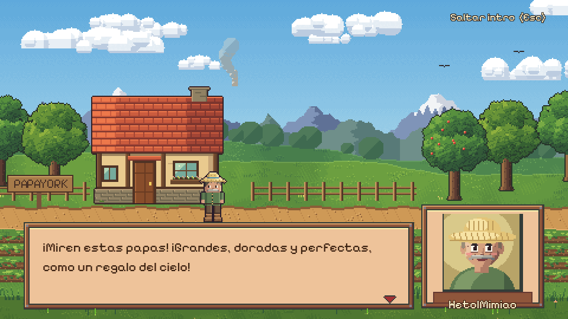</td>
    <td>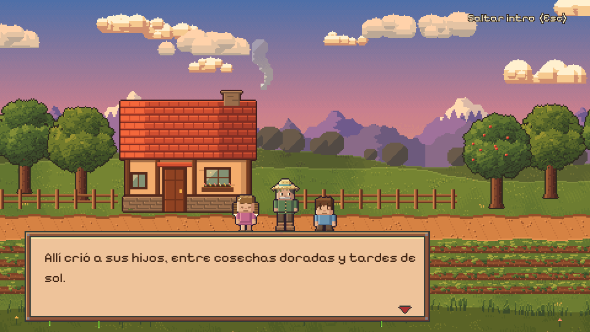</td>
  </tr>
  <tr>
    <td>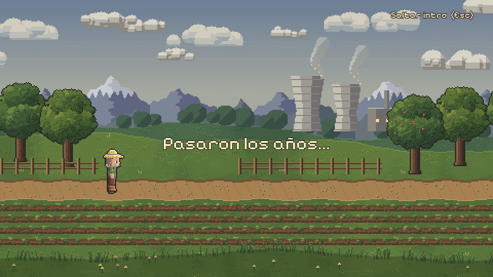</td>
    <td>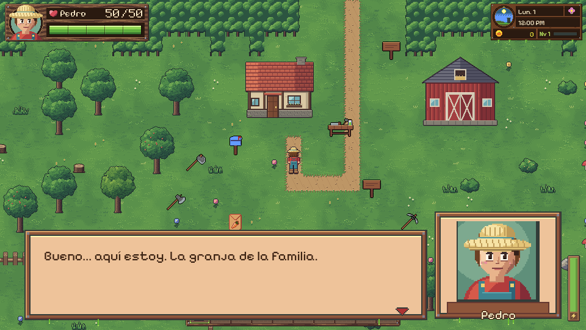</td>
  </tr>
</table>

## Qué se puede hacer

<table>
  <tr>
    <td width="50%" valign="top">
      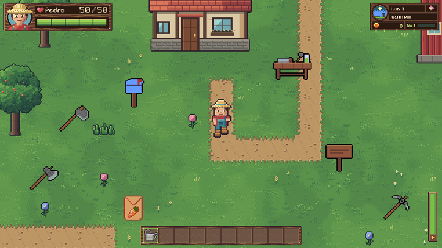<br>
      <b>La granja</b><br>
      Ará la tierra, siembra, riega y cosecha. Los cultivos crecen por días y el día cambia cuando Pedro duerme. Si se queda despierto hasta las 2 AM se desmaya. Una papa sembrada puede mutar y salir a comerse el resto del huerto, salvo que haya un espantapapas cerca.
    </td>
    <td width="50%" valign="top">
      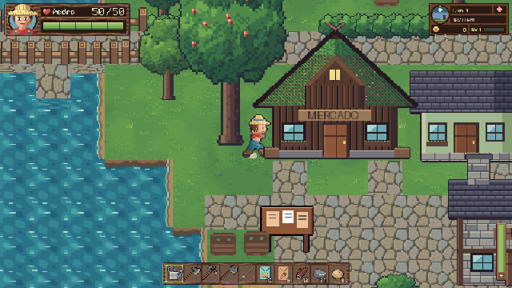<br>
      <b>El pueblo</b><br>
      Doña Rosa vende semillas en el mercado y Don Fermín mejora la espada, el hacha y el pico con lingotes de cobre o hierro. Cada vecino tiene su rutina por horas, entra y sale de su casa y sube de amistad si le hablas o le regalas algo que le gusta.
    </td>
  </tr>
  <tr>
    <td width="50%" valign="top">
      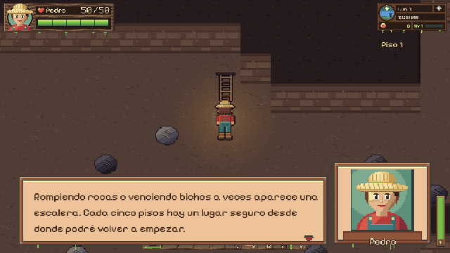<br>
      <b>La mina</b><br>
      Cada piso se genera al azar con un evento de JavaScript. Hay tres zonas, un piso de descanso cada cinco y seis tipos de enemigos que persiguen a Pedro. Las papas retroceden al recibir un golpe.
    </td>
    <td width="50%" valign="top">
      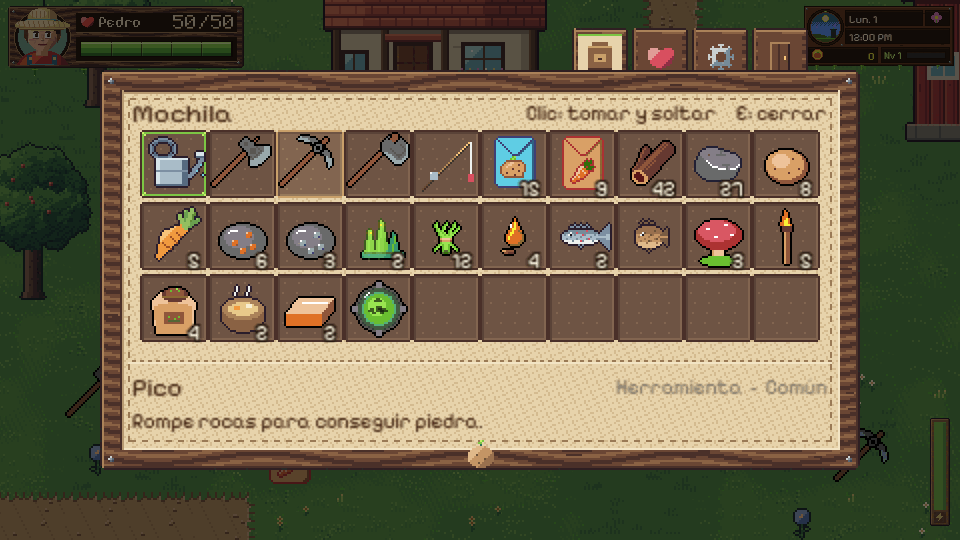<br>
      <b>La mochila</b><br>
      30 casillas, barra rápida del 1 al 0, objetos que se apilan y una ficha con nombre, tipo y rareza al pasar el mouse. Desde la misma ventana se abren la pausa, las opciones y la pestaña de vecinos con los corazones de amistad.
    </td>
  </tr>
</table>

Otras cosas que ya funcionan:

- Calendario de estaciones de 28 días, reloj en el HUD, monedas, nivel y experiencia.
- Mesa de trabajo con recetas: cercas, antorchas, abono, espantapapas, horno y lingotes.
- Pesca con minijuego de barra.
- Casas en las que se entra, con ocho salas distintas, y seis páginas del diario de HetolMimiao escondidas.
- Tres partidas guardadas, guardado automático al cambiar de zona y opción de borrar una partida.
- Música propia que no se corta al pasar de una escena a otra.

## Mundo

| Granja | Bosque | Pueblo |
|:---:|:---:|:---:|
| 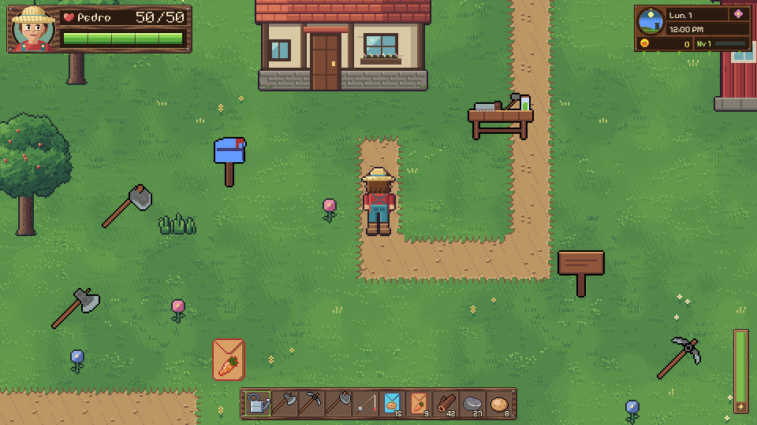 | 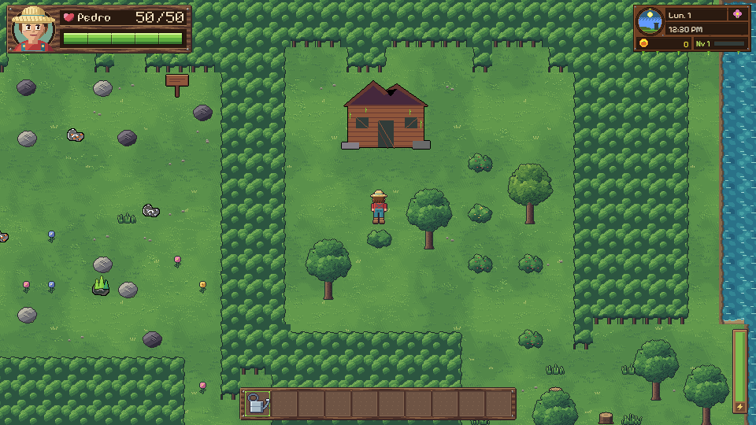 | 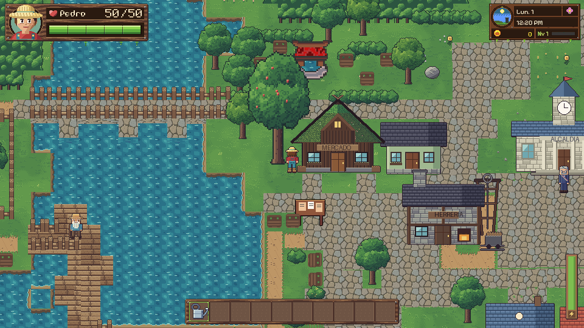 |

<p align="center">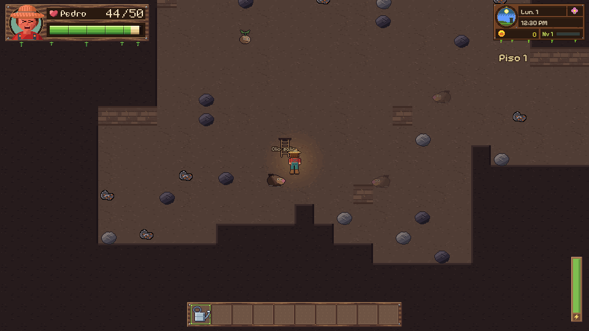</p>

## Controles

| Tecla | Acción |
|---|---|
| `W` `A` `S` `D` | Moverse (corre por defecto) |
| `Shift` | Caminar |
| `Espacio` | Usar la herramienta o atacar |
| `1` a `0` / rueda del mouse | Elegir casilla de la barra rápida |
| `E` | Abrir y cerrar la mochila (pausa el mundo) |
| Clic | Hablar, entrar a casas, comprar y vender |
| `G` | Guardar |
| `Z` | Cambiar el zoom del mundo |
| `Esc` | Saltar la introducción |

## Cómo abrirlo

1. Instala [GDevelop 5](https://gdevelop.io/download) (el proyecto se hizo con la 5.6.283).
2. Clona el repositorio:
   ```bash
   git clone https://github.com/fabiiianac15/PapaYork.git
   ```
3. En GDevelop abre `Legado Radioactivo-Papayork.json` y dale a **Vista previa**.

Para sacar un ejecutable usa *Archivo → Exportar* (HTML5, Windows o Linux).

## Cómo está hecho

Las escenas se arman en GDevelop con eventos visuales y eventos externos compartidos (`Personaje`, `Inventario`, `Herramientas`, `Cultivos`, `Dialogo`, `Rutinas`, `EnemigosMina` y otros). Varias extensiones propias resuelven partes concretas: `Rejilla` marca la casilla que tiene enfrente Pedro, `YSort` ordena la profundidad y `PanelSpriteContinuousBar` dibuja las barras.

Una parte grande del juego salió de scripts de Python que editan el JSON del proyecto. Cada cambio grande vive en [`arte/cambios/`](arte/cambios) con un número y una descripción al inicio del archivo, desde `01_reloj.py` hasta `29_retroceso_y_vida.py`. El historial de commits de este repositorio sigue ese mismo orden.

El arte de [`Natural/`](Natural) se dibujó por código: los personajes y la interfaz con archivos `.px.js` y el terreno con scripts de Python en [`arte/`](arte). La música también se sintetizó con un script (`arte/natural_audio.py`) y no usa muestras externas.

```
├── Legado Radioactivo-Papayork.json   proyecto de GDevelop
├── Natural/        arte y música nuevos
├── Menu/ HUD/ Inventario/ Cultivos/ Recursos/ ...   sprites por sistema
├── assets/         arte de la primera versión
├── arte/           generadores de arte y scripts que modifican el proyecto
│   └── cambios/    un script por cada cambio grande (01 a 29)
└── docs/media/     capturas y GIFs de este README
```

## Créditos

Hecho por **Fabián José Acosta** para la materia Desarrollo de Videojuegos de la Universidad Francisco de Paula Santander Ocaña (UFPSO).

- Fuente [Pixelify Sans](https://fonts.google.com/specimen/Pixelify+Sans), licencia SIL Open Font.
- Las mecánicas toman ideas de *Stardew Valley* (ConcernedApe). No se copió su código, arte, texto ni música.
- Detalle de autoría del arte y la música en [`CREDITOS.md`](CREDITOS.md).
